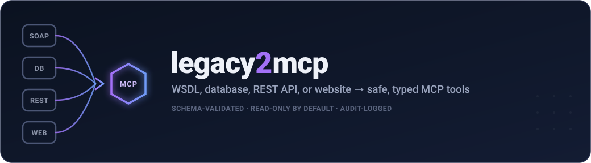
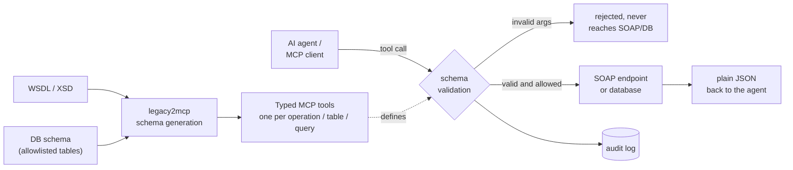

<!-- mcp-name: io.github.bvenkata/legacy2mcp -->

<div align="center">



<p>
  <a href="https://github.com/bvenkata/legacy2mcp/actions/workflows/ci.yml"></a>
  <a href="https://pypi.org/project/legacy2mcp/"></a>
  <a href="https://pypi.org/project/legacy2mcp/"></a>
  <a href="https://registry.modelcontextprotocol.io/v0.1/servers?search=io.github.bvenkata/legacy2mcp"></a>
  <a href="https://glama.ai/mcp/servers/bvenkata/legacy2mcp"></a>
  <a href="LICENSE"></a>
</p>

<p><b>Point it at a WSDL or a database. Get an MCP server whose tools can't drift from the underlying schema, can't send unvalidated arguments, and can't call write operations (or run arbitrary SQL) you didn't opt into.</b></p>


</div>

---

> [!NOTE]
> `legacy2mcp` introspects a legacy system — every operation in a WSDL, or a database's live schema — builds a real JSON Schema for each tool **from that introspected schema**, and exposes them as [MCP](https://modelcontextprotocol.io/) tools — with **every call schema-validated before it reaches your SOAP endpoint or database**, **write-like/write operations excluded by default**, and **every call audit-logged**. No hand-written adapter code, no hand-maintained schemas, no arbitrary SQL from the LLM.

## Contents

- [Install](#install)
- [Quick start](#quick-start)
- [How it works](#how-it-works)
- [Point it at your own WSDL](#point-it-at-your-own-wsdl)
- [Point it at your own database](#point-it-at-your-own-database)
- [Point it at your own REST API](#point-it-at-your-own-rest-api)
- [Generate a config automatically](#generate-a-config-automatically)
- [Use it from Claude Desktop](#use-it-from-claude-desktop-or-any-mcp-client)
- [What's handled](#whats-handled)
- [Safety model](#safety-model)
- [Use cases](#use-cases)
- [Real-world usage](#real-world-usage)
- [Configuration reference](#configuration-reference)
- [Roadmap](#roadmap)
- [Development](#development) · [Contributing](#contributing) · [License](#license)

## Install

```bash
# Full install (recommended)
pip install "legacy2mcp[ai]"

# Or the identical, scan-only-ready core -- AI-assisted `legacy2mcp init`
# needs no extra package either way, just an API key at runtime; `[ai]`
# above installs nothing extra today, it's just a stable, familiar name
pip install legacy2mcp
# or:  uv tool install legacy2mcp   ·   pipx install legacy2mcp
```

Also published to the **[MCP Registry](https://registry.modelcontextprotocol.io/v0.1/servers?search=io.github.bvenkata/legacy2mcp)** as `io.github.bvenkata/legacy2mcp`, so registry-aware MCP clients can discover it directly.

## Quick start

No API key, no cloning, no local setup — point `legacy2mcp init` at a real,
public REST API (it tries OpenAPI/Swagger discovery against it) and
generate a working config in one command:

```bash
legacy2mcp init --rest-url "https://petstore3.swagger.io/api/v3" --out config.yaml
legacy2mcp inspect --config config.yaml   # see the generated MCP tools
```

Or run it with no flags for the interactive menu (WSDL URL / REST API URL /
GitHub repo) — see [Generate a config automatically](#generate-a-config-automatically)
for what each option does and when it needs an API key (hint: none of them
need one unless you're pointing it at a GitHub repo and want AI-assisted
help with ambiguous code):

```bash
legacy2mcp init
```

### Demo targets (nothing of your own required)

| Demo | Setup | What you get |
|---|---|---|
| **REST: public Swagger Petstore** | none â [`examples/rest/config.petstore.yaml`](examples/rest/config.petstore.yaml) | 4 read tools; `delete_pet` hidden as a write |
| **SOAP: sample Orders WSDL** | `python examples/soap/mock_orders_service.py` â [`config.orders.yaml`](examples/soap/config.orders.yaml) | `GetOrder`, `ListOrders`, `GetInventory`; `CreateOrder` / `CancelOrder` hidden as writes |
| **SOAP: WSDL by URL** | none â [`config.orders.public-wsdl.yaml`](examples/soap/config.orders.public-wsdl.yaml) points at the sample WSDL in this repo | tool discovery with `inspect` (no calls) |

Hook any of them up to Claude Desktop, Claude Code or Cursor with the snippets in
[Use it from Claude Desktop](#use-it-from-claude-desktop-or-any-mcp-client).

<details>
<summary>Prefer a fully offline demo? Run the bundled mock SOAP service</summary>

```bash
git clone https://github.com/bvenkata/legacy2mcp.git
cd legacy2mcp
pip install -e ".[dev]"

# 1. start the demo SOAP service (dneonline-style Calculator WSDL)
python examples/soap/run_mock_calculator.py &

# 2. see the MCP tools generated from its WSDL
legacy2mcp inspect --config examples/soap/config.calculator.yaml
```

Or with Docker:

```bash
docker compose up demo-soap-service -d
docker compose run --rm legacy2mcp legacy2mcp inspect \
  --config examples/soap/config.calculator.docker.yaml
```
</details>

## How it works



**SOAP:**
1. Loads the WSDL with [`zeep`](https://docs.python-zeep.org/), a mature, widely-used Python SOAP client.
2. For every operation on every port/binding, converts the XSD input type into a JSON Schema ([`schema/xsd_to_jsonschema.py`](src/legacy2mcp/schema/xsd_to_jsonschema.py)) — simple types, nested complex types, enums and arrays, recursively, depth-limited for pathological WSDLs.
3. Registers one MCP tool per operation, named `<adapter_id>_<OperationName>`.
4. On a tool call: validates arguments with `jsonschema` (schemas use `additionalProperties: false`), calls the operation via `zeep`, serializes the response to plain JSON, and writes an audit entry.

**DB:**
1. Connects with the dialect's driver (`psycopg` / `pyodbc` / `oracledb`, imported lazily) and introspects the live column types for each allowlisted table ([`adapters/db_dialects.py`](src/legacy2mcp/adapters/db_dialects.py)) into JSON Schema ([`schema/sql_to_jsonschema.py`](src/legacy2mcp/schema/sql_to_jsonschema.py)).
2. Registers `select_<table>` / `insert_<table>` per allowlisted table-and-operation, plus `query_<name>` per named query in config.
3. On a tool call: validates arguments, builds SQL from the allowlisted table/columns (or runs the config-supplied named query) using one dialect-neutral `:param` placeholder convention, executes it, and writes an audit entry. The LLM never sees or writes SQL text.
5. Operations whose names look like writes are excluded unless `allow_write_operations: true`.

## Point it at your own WSDL

```yaml
# config.yaml
server:
  name: my-legacy-mcp

adapters:
  - id: legacy
    type: soap
    config:
      wsdl_url: "https://service.example.com/LegacyService?wsdl"
      auth:
        type: basic
        username: "svc-account"
        password_env: "SERVICE_PASSWORD"   # value read from the environment, never the file
      allow_write_operations: false        # Create*/Update*/Delete*/… stay hidden
      include_operations: ["GetRecord", "GetRecordDetails", "SearchRecords"]

security:
  audit:
    enabled: true
    path: "./legacy-mcp-audit.log"
```

```bash
export SERVICE_PASSWORD=...
legacy2mcp inspect --config config.yaml   # review the generated tools
legacy2mcp run     --config config.yaml   # start the MCP server (stdio)
```

A production-shaped template with comments lives at [`examples/soap/config.template.yaml`](examples/soap/config.template.yaml).

## Point it at your own database

```bash
pip install "legacy2mcp[db-postgres]"   # or db-mssql / db-oracle
```

```yaml
# config.yaml
adapters:
  - id: orders
    type: db
    config:
      dialect: postgres             # postgres | mssql | oracle
      dsn_env: "ORDERS_DB_DSN"      # connection string, read from the environment
      allow_write_operations: false # insert_<table> / write: true queries stay hidden
      tables:
        - name: orders
          operations: [select]
          columns: [id, status, total, created_at]   # column allowlist
          filterable_columns: [status]                # equality filters on select_orders
          max_rows: 200
      queries:
        - name: orders_by_status_since
          sql: "SELECT id, status, total FROM orders WHERE status = :status AND created_at >= :since"
          params:
            - { name: status, type: string, required: true }
            - { name: since, type: string, required: true }
```

```bash
export ORDERS_DB_DSN=...
legacy2mcp inspect --config config.yaml   # review the generated tools
```

Columns are introspected from the live schema at startup, the same way SOAP operation
schemas come from the WSDL -- there's nothing to hand-maintain. **There is no path from
the LLM to arbitrary SQL, ever**: it can only call `select_<table>` / `insert_<table>` for
tables listed under `tables:`, or a `query_<name>` tool whose SQL you wrote under
`queries:` -- the LLM supplies only the placeholder values a query's `params` declare,
never SQL text. A production-shaped template lives at
[`examples/db/config.template.yaml`](examples/db/config.template.yaml).

## Point it at your own REST API

There's no WSDL or live database schema to introspect a plain REST/JSON API
from, so the `rest` adapter's endpoint list is explicit config -- write it
by hand, or generate a starting point with `legacy2mcp init` (next
section).

```yaml
# config.yaml
adapters:
  - id: orders
    type: rest
    config:
      base_url: "https://api.example.com"
      auth:
        type: bearer
        token_env: "ORDERS_API_TOKEN"
      allow_write_operations: false
      endpoints:
        - name: get_order
          method: GET
          path: "/orders/{order_id}"
          params:
            - { name: order_id, location: path, type: integer, required: true }
        - name: create_order
          method: POST
          path: "/orders"
          write: true   # stays hidden unless allow_write_operations: true
          params:
            - { name: total, location: body, type: number, required: true }
```

A production-shaped template lives at
[`examples/rest/config.template.yaml`](examples/rest/config.template.yaml).

> [!NOTE]
> Both a non-`GET` method and an LLM-assisted classification are
> heuristics, not a guarantee the endpoint is actually safe to call
> unsupervised -- review `write:` flags and `allow_write_operations` before
> running against a real backend, same caveat as the SOAP adapter's
> write-verb heuristic below.

## Generate a config automatically

`legacy2mcp init` asks what to point it at, then writes a starting
`config.yaml` for you:

```bash
legacy2mcp init
```

```
What do you want to point legacy2mcp at?
  1) WSDL URL (SOAP service)
  2) REST API URL (tries OpenAPI/Swagger discovery)
  3) GitHub repo URL or a local path to its source code
Choice [1-3]:
```

| Option | What happens | Needs an LLM key? |
|---|---|---|
| **WSDL URL** | Points a `soap` adapter at it directly -- `zeep` introspects the live WSDL at `inspect`/`run` time anyway, so nothing needs scanning up front. | No |
| **REST API URL** | Tries the common OpenAPI/Swagger spec locations (`/openapi.json`, `/swagger.json`, ...) against that URL and builds the `rest` adapter's endpoint list from the real spec if one's found; an empty scaffold otherwise. | No |
| **GitHub repo / local path** | Clones (or reads) the repo and statically scans its Python source (AST only, never executed) for a `zeep.Client(...)` call, a SQLAlchemy/Flask-SQLAlchemy model, or Flask/FastAPI routes -- picking `soap`/`db`/`rest` accordingly. | Optional |

Each also works non-interactively via a flag -- `--wsdl-url`, `--rest-url`,
`--github-url`, or `--local-path` -- for scripting or CI. Only the GitHub/
source-code path can use an LLM, and only to refine what static analysis
already found (ambiguous parameter types, read-vs-write classification) --
never a dump of your repo. It needs no extra dependency, just an
OpenAI-compatible API key via `--llm-api-key-env`, or an interactive hidden
prompt if you omit that (never written to disk); pass `--scan-only` to skip
it outright and run static-analysis-only, same as not entering a key.

```bash
legacy2mcp init --github-url https://github.com/you/your-api --scan-only --out config.yaml
```

Whichever path you take, review the generated file before running it --
it's marked up with `# TODO` comments for anything that couldn't be
confidently inferred (an unresolved `base_url`, an unverified param type,
which endpoints got classified `write: true`), and nothing in it is
verified against the real backend until you do:

```bash
legacy2mcp inspect --config config.yaml   # review the generated tools
legacy2mcp run     --config config.yaml   # start the MCP server
```

See [docs/security.md](docs/security.md) for exactly what this heuristic
does and doesn't guarantee before pointing it at anything real.

## Use it from Claude Desktop (or any MCP client)

Each client launches `uvx legacy2mcp run --config <absolute path>` over stdio. If you installed
with `pip` or `pipx`, use `legacy2mcp` in place of `uvx legacy2mcp`.

**Claude Desktop** (`claude_desktop_config.json`)

```json
{
  "mcpServers": {
    "legacy2mcp": {
      "command": "uvx",
      "args": ["legacy2mcp", "run", "--config", "/absolute/path/to/config.yaml"]
    }
  }
}
```

**Claude Code**

```bash
claude mcp add legacy2mcp -- uvx legacy2mcp run --config /absolute/path/to/config.yaml
```

**Cursor** (`.cursor/mcp.json`)

```json
{
  "mcpServers": {
    "legacy2mcp": {
      "command": "uvx",
      "args": ["legacy2mcp", "run", "--config", "/absolute/path/to/config.yaml"]
    }
  }
}
```

VS Code, passing secrets, and troubleshooting: [docs/clients.md](docs/clients.md).

## What's handled

| Area | Covered |
|---|---|
| **Type mapping** | `string` / `int` / `long` / `decimal` / `boolean` / `date` / `dateTime` / `base64Binary` / … → JSON Schema types + formats |
| **Structure** | nested complex types, repeated elements → arrays, `xsd:enumeration` → `enum`, recursion depth-limited |
| **Discovery** | every service → port → binding → operation; duplicate tool names rejected at startup |
| **Invocation** | argument validation, `zeep` call, response serialized to plain JSON, single-field responses re-wrapped to a named result |
| **Errors** | SOAP faults and transport errors caught and returned as clean messages — no stack traces to the caller |
| **Auth** | HTTP basic (username + `*_env` password); bearer token (`*_env`); anonymous |
| **Transport** | `stdio` (the transport Claude Desktop and most agent frameworks spawn) |
| **DB dialects** | Postgres, SQL Server, Oracle — table allowlist (`select`/`insert`) with live schema introspection, plus named parameterized queries |
| **REST** | explicit endpoint allowlist (method + path + typed params) from config or `legacy2mcp init` — no live schema to introspect, so nothing here is verified until you run it |

See [docs/security.md](docs/security.md) for the full, honest security model — what's covered today and what isn't yet.

## Safety model

| Layer | What it does |
|---|---|
| **Schema validation** | No arguments reach the SOAP/DB layer without passing `jsonschema.validate` against that tool's generated schema. |
| **Read-only by default** | SOAP: operation names are matched against write-verb prefixes (`Create`, `Update`, `Delete`, `Cancel`, `Void`, `Submit`, `Pay`, …). DB: tables/queries are explicit opt-in, and `insert`/write-marked queries additionally require it. Neither is exposed unless you set `allow_write_operations: true`. |
| **Explicit allow / deny** | SOAP: `include_operations` / `exclude_operations`. DB: a table/column allowlist — there's no equivalent of "all tables" or arbitrary SQL. |
| **Audit log** | One JSON line per call — tool, arguments, timestamp, outcome, duration. |
| **Secret hygiene** | Credentials and DB connection strings come from named environment variables; the YAML stays safe to commit. |

> [!WARNING]
> The SOAP write-operation filter is a **name heuristic, not semantic analysis** — an operation called `ProcessRecord` that deletes data would not be caught. For any system where a wrong call has real consequences, set `include_operations` explicitly and don't rely on the heuristic. The DB adapter's allowlist is explicit by construction, but **there's no column-level data masking** — an allowlisted column's values are always returned as-is. There is also no auth/authz on the MCP server itself yet — don't expose a server to untrusted callers. Details in [docs/security.md](docs/security.md).

## Use cases

| Domain | Shape |
|---|---|
| **Systems of record** | An agent reads status/detail records from a legacy back-office platform, read-only, every lookup logged. |
| **Financial services** | Expose account and transaction *reads* without exposing transfers or adjustments. |
| **Supply chain / ERP** | Surface order status, inventory, shipment tracking from an old SOAP middleware layer. |
| **Internal support tooling** | A support copilot gets safe, typed access to the system of record instead of a scraped UI. |
| **Migration & modernization** | Put an MCP layer in front of a legacy service now; swap the backend later without touching the agent. |

## Real-world usage

### In CI/CD — catch WSDL drift before it reaches production

`legacy2mcp inspect` loads the config, contacts the WSDL, builds every schema, and exits non-zero if anything fails:

```yaml
- name: Check the WSDL still generates valid MCP tools
  env:
    SERVICE_PASSWORD: ${{ secrets.SERVICE_PASSWORD }}
  run: |
    pip install legacy2mcp
    legacy2mcp inspect --config config/legacy.yaml > tools.json
    git diff --exit-code --no-index tools/legacy.snapshot.json tools.json  # optional: pin the contract
```

### As a sidecar / long-running MCP server

`legacy2mcp run` speaks MCP over stdio. Package it with your config using the provided [`Dockerfile`](Dockerfile) and let your MCP client launch it.

### In a data pipeline

Call the same generated, validated tools from your own code via any MCP client library to pull records on a schedule — the audit log records exactly what was fetched.

## Configuration reference

| Key | Default | Meaning |
|---|---|---|
| `server.name` | `legacy2mcp` | MCP server name reported to clients |
| `server.transport` | `stdio` | only `stdio` is implemented so far |
| `adapters[].id` | — | prefix for this adapter's tool names |
| `adapters[].type` | — | `soap`, `db`, or `rest` (implemented); `queue` is on the roadmap |

**SOAP adapter config:**

| Key | Default | Meaning |
|---|---|---|
| `adapters[].config.wsdl_url` | — | WSDL location (`http(s)://…?wsdl` or a file path) |
| `adapters[].config.auth` | `{type: none}` | `none` or `{type: basic, username, password_env}` |
| `adapters[].config.allow_write_operations` | `false` | expose write-like operations |
| `adapters[].config.include_operations` | all | allowlist of operation names |
| `adapters[].config.exclude_operations` | `[]` | denylist of operation names |
| `adapters[].config.timeout_seconds` | `15` | per-call SOAP timeout |

**DB adapter config:**

| Key | Default | Meaning |
|---|---|---|
| `adapters[].config.dialect` | — | `postgres`, `mssql`, or `oracle` |
| `adapters[].config.dsn_env` | — | env var holding the connection string/DSN |
| `adapters[].config.allow_write_operations` | `false` | expose `insert_<table>` and `write: true` queries |
| `adapters[].config.timeout_seconds` | `15` | connection timeout |
| `adapters[].config.tables[].name` / `.schema` | — | table (and optional schema/owner) to allowlist |
| `adapters[].config.tables[].operations` | `[select]` | `select` and/or `insert` |
| `adapters[].config.tables[].columns` | all introspected | column allowlist |
| `adapters[].config.tables[].filterable_columns` | `[]` | columns usable as equality filters on `select_<table>` |
| `adapters[].config.tables[].max_rows` | `200` | row cap, enforced after the query runs |
| `adapters[].config.queries[].name` / `.sql` / `.params` | — | a named query; `sql` uses `:param_name` placeholders |
| `adapters[].config.queries[].write` | `false` | gates this query behind `allow_write_operations` |

**REST adapter config:**

| Key | Default | Meaning |
|---|---|---|
| `adapters[].config.base_url` | — | base URL the configured endpoints are relative to |
| `adapters[].config.auth` | `{type: none}` | `none`, `{type: basic, username, password_env}`, or `{type: bearer, token_env}` |
| `adapters[].config.allow_write_operations` | `false` | expose endpoints marked `write: true` |
| `adapters[].config.timeout_seconds` | `15` | per-call HTTP timeout |
| `adapters[].config.endpoints[].name` / `.method` / `.path` / `.description` | — | one allowlisted endpoint; `path` uses `{param}` placeholders for path params |
| `adapters[].config.endpoints[].params[].name` / `.location` / `.type` / `.required` | — | `location` is `path`, `query`, or `body` |
| `adapters[].config.endpoints[].write` | `false` | gates this endpoint behind `allow_write_operations` |

**Security config:**

| Key | Default | Meaning |
|---|---|---|
| `security.audit.enabled` | `true` | write the audit log |
| `security.audit.path` | `./legacy2mcp-audit.log` | audit log location |

## Roadmap

| Version | Scope | Status |
|---|---|---|
| **v0.1** | SOAP/WSDL adapter, schema generation, validation, read-only default, audit log, `run` + `inspect` CLI, basic auth, stdio | ✅ shipped |
| **v0.2** | Database adapter (Postgres / SQL Server / Oracle; table/operation allowlists + named parameterized queries, no arbitrary SQL ever) | ✅ shipped |
| **v0.2.x** | REST adapter (explicit endpoint allowlist); `legacy2mcp init` -- scans a repo (SOAP client / ORM models / Flask/FastAPI routes) and generates a starter config, with optional OpenAI-compatible LLM assist for ambiguous bits | ✅ shipped |
| v0.2.x | HTTP/SSE transport, role→tool authorization, OAuth2 for SOAP | planned |
| v0.3+ | Queue adapter (Kafka/RabbitMQ/SQS), workflow composition with approval gates, OpenTelemetry export | ideas |

Full detail in [docs/roadmap.md](docs/roadmap.md). The [`BaseAdapter`](src/legacy2mcp/adapters/base.py) interface (`discover_tools()` + `invoke()`) is the extension point — the server core handles validation, dispatch and audit for any adapter.

## Development

```bash
pip install -e ".[dev]"
pytest tests/ -v
```

Tests run against an in-process mock SOAP service and an in-process SQLite-backed
stand-in for the DB adapter — no network, no real Postgres/SQL Server/Oracle
required. The DB adapter's Postgres/SQL Server/Oracle dialects (`db_dialects.py`)
have their SQL-translation logic covered by driver-free unit tests; connecting to
a real instance of each is not part of the default suite.

CI runs the suite on Python 3.10–3.12 ([`ci.yml`](.github/workflows/ci.yml)). Releases to PyPI and the MCP Registry are tag-triggered — see [docs/releasing.md](docs/releasing.md). The demo GIF is regenerated with `vhs demo/demo.tape` ([`demo/`](demo/)).

## Contributing

Adapters for new legacy systems are the highest-value contribution — implement `BaseAdapter` and the core handles the rest. Issues and PRs welcome.

## License

[Apache 2.0](LICENSE)

<div align="center"><sub>legacy2mcp · <a href="https://github.com/bvenkata/legacy2mcp">github.com/bvenkata/legacy2mcp</a></sub></div>
